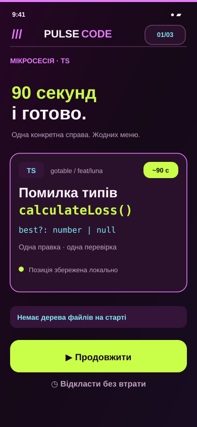
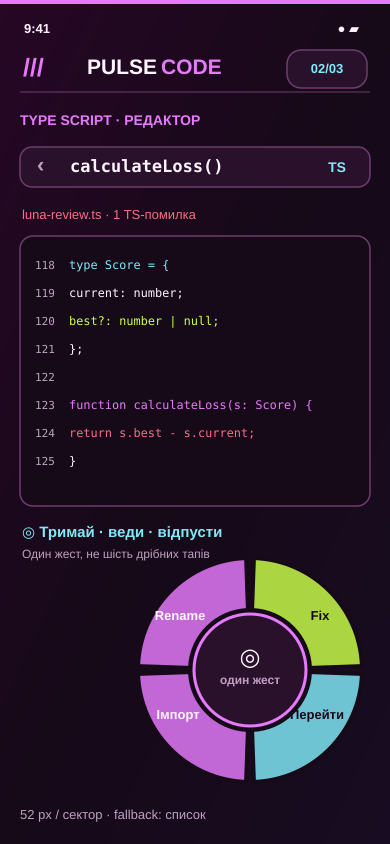
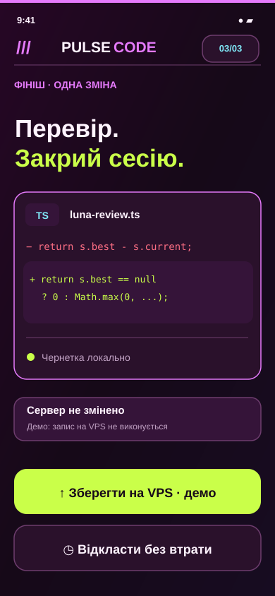

# PULSE CODE · три екрани справжнього mobile-first

Не зменшений VS Code: **одна TypeScript-мікросесія, одна жестова дія, одне підтвердження**. Це дизайн-макети, не знімки робочого редактора.

**[▶ Відкрити клікабельний UX-прототип](https://tools.mandrock.me/mdfocus/pulse-code-demo.html)** · одна рука, чотири сектори, підтримка звичайного тапу та паузи.

## 01. 90 секунд: конкретна задача

На головному екрані немає каталогу, вкладок і термінала: є відновлюваний TS-контекст і одна головна дія.

## 02. TypeScript Modwheel: жест замість дрібних тапів

Тримай великий майданчик → проведи до одного з чотирьох секторів (52 px всередині) → відпусти. Звичайний тап відкриває великий список. Праворуч/ліворуч перемикається.

## 03. Один diff: зберегти чи відкласти

Лише зміна поточного фрагмента й явний статус: локально чи на VPS. Commit, push і деплой не запускаються випадково.

**[Читати повну чернетку](https://read.mandrock.me/drafts/item/pulse-code-mobile-first-editor/)** · приватний розділ, потрібен вхід.

Торкнися кожного зображення для повноекранного перегляду. У прототипі немає backend для реального збереження.
