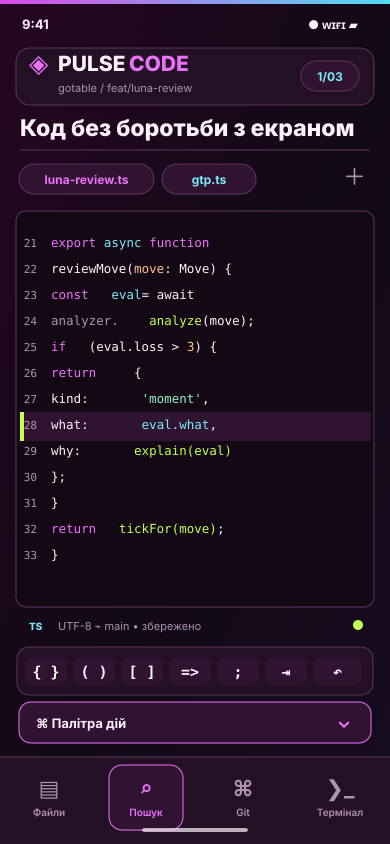
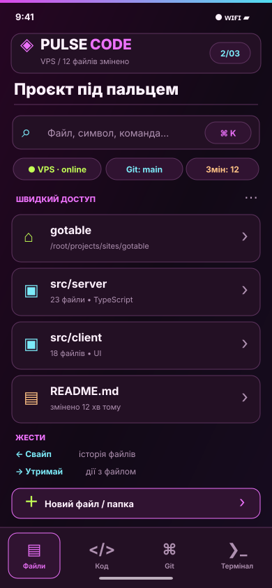
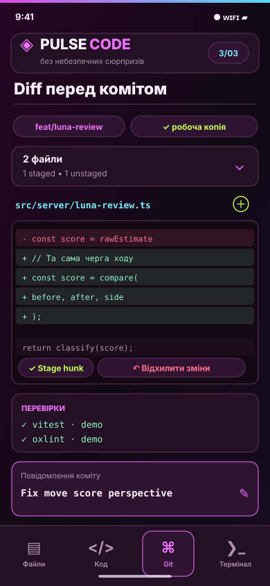

# Три екрани PULSE CODE

Мобільний кодовий редактор, спроєктований спершу для великого пальця, а не для курсора миші. Це **концепти**, не скриншоти готового застосунку.

## 01 · Редактор без шуму

Редактор з панеллю парних дужок, комбінаціями клавіш, швидким пошуком і видимим станом збереження.

## 02 · Увесь проєкт під пальцем

Швидке відкриття файлів, перемикання між локальними й віддаленими джерелами та велика зона дій унизу.

## 03 · Git без випадкового push

Hunk-level staging, тести та окремий підтверджуваний крок для публікації змін. Без автоматичного force push.

Торкнися кожного зображення, щоб відкрити його на весь екран. Закрити можна кнопкою або клавішею Escape.
