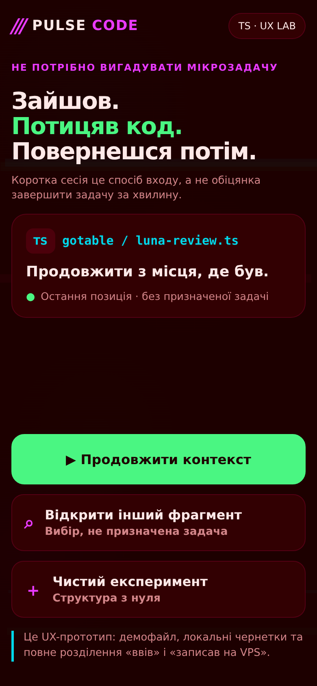
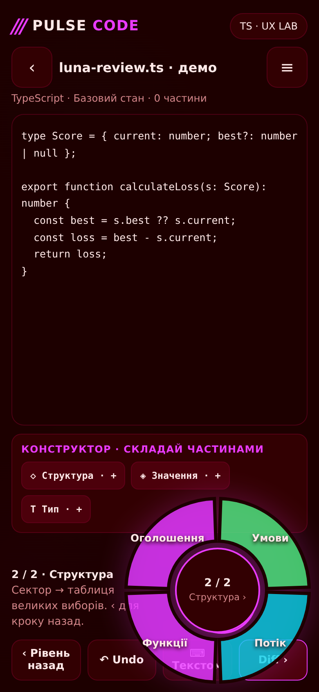
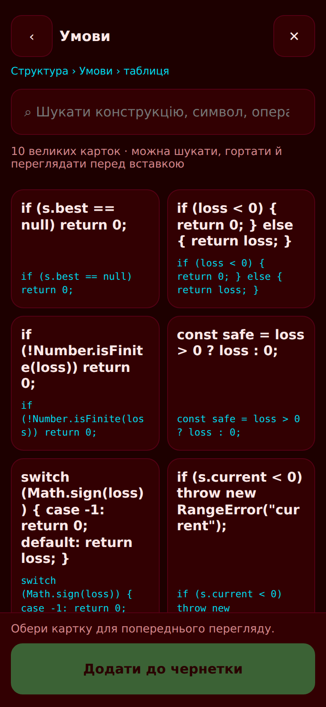

# PULSE CODE · TypeScript через ієрархію жестів

Це **скриншоти робочого UX-прототипу v3**, а не рендер неіснуючих контролів. Перший реліз не обіцяє магічну «90-секундну задачу»: людина повертається в код і сама вирішує, що робити.

**[Відкрити інтерактивний прототип на телефоні](https://tools.mandrock.me/mdfocus/pulse-code-grammar-v3.html)** · спробуй утримати велике коло, обрати розділ, підрозділ і потім картку.

## 01 · Вхід без наперед придуманої задачі

Продовжити останній контекст, вибрати файл чи почати чистий scratchpad. Без нав'язаної кінцевої точки.

## 02 · Дворівневе секторне Modwheel

Перший рівень: **Структура / Значення / Типи / Дії**. Другий: чотири підрозділи обраної родини. Вибір підгрупи веде у повноекранну таблицю. Звичайний тап відкриває доступний список, без жестового примусу.

## 03 · Повноекранна таблиця великих TypeScript-карток

Ніяких восьми секторів для сотні можливостей. У таблиці є пошук, прев'ю, скрол і велика кнопка «Додати до чернетки»; зміни локальні й мають Undo.

**[Повна приватна продуктова чернетка v3](https://read.mandrock.me/drafts/item/pulse-code-mobile-first-editor/)**

*Технічна межа демо:* тут немає реального `tsserver`, typecheck, Git або запису на VPS. Поки що це вивіряння вводу та інформаційної архітектури.
