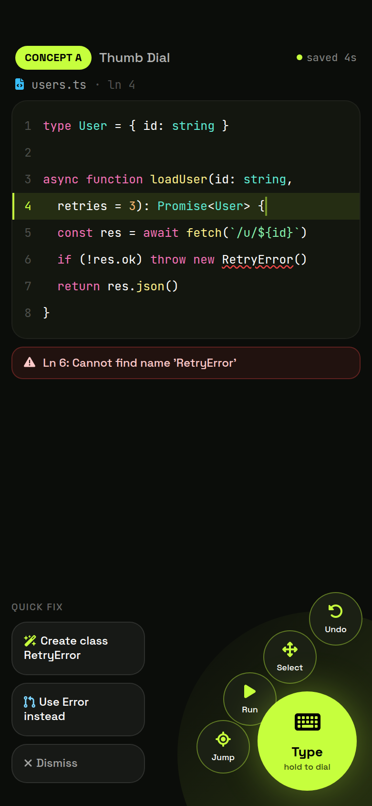
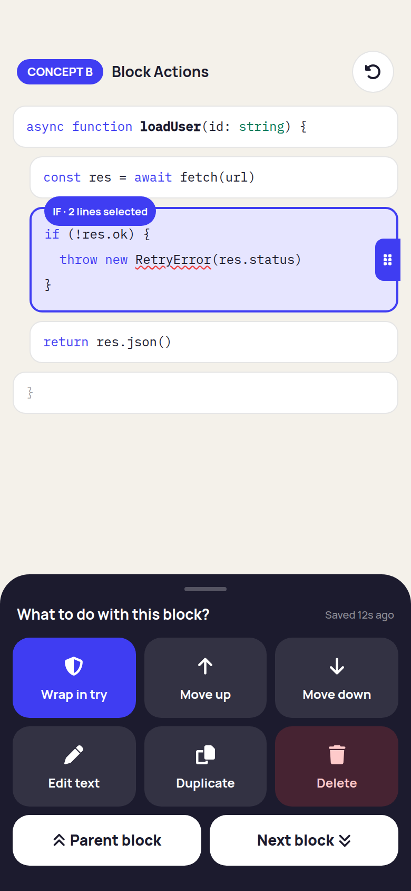
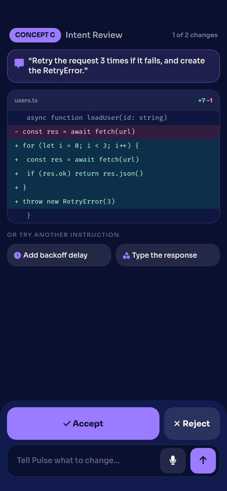
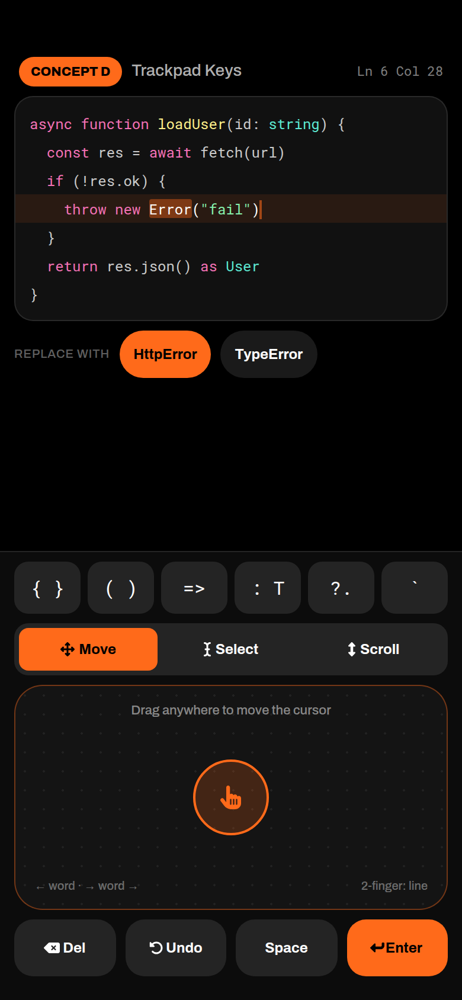

# PULSE CODE: чотири концепти від UX Pilot

Одна генерація UX Pilot через приватний VPS rig, 21.11.2026. Нижче саме **рендери провайдера**, не наші перероблені UI. Кожен повнорозмірний: 390×844, можна натиснути й збільшити у MDfocus.

## A · Thumb Dial

**Ідея:** код займає більшість екрана, колесо в нижньому кутку, помилка та quick fixes. **Слабкість:** радіальний хаб не пояснює, як редагувати вкладені довільні вирази; це не Duolingo-подібний конструктор.

## B · Block Actions

**Ідея:** торкатися AST-подібних блоків замість позиціонування курсора; контекстні дії знизу. **Сильна сторона:** великі мішені й очевидна наступна дія. **Слабкість:** код розірваний на картки, складні вкладення й рядки можуть стати незручними.

## C · Intent Review

**Ідея:** описати зміну природною мовою, перевірити diff, прийняти/відхилити. **Сильна сторона:** добре для коротких втручань. **Слабкість:** це шар review для агентного редагування, а не самодостатній спосіб писати довільний TS; потребує реального виконання й перевірки результату.

## D · Trackpad Keys

**Ідея:** великий невиділений трекпад для курсора та додаткова панель TS-символів. **Сильна сторона:** мінімально порушує звичайне текстове редагування. **Слабкість:** забирає майже половину екрана й не розв'язує проблему точного вибору вузла на рівні AST.

---

**Попередній вибір для наступного прототипу:** B як базова навігація по структурах + C тільки як опційний review, не заміна редактора. Це гіпотеза, а не UX-тест із користувачем.

Важлива межа: запит, який фактично прийняв UX Pilot через rig, був **обрізаний після вступного абзацу** через X11-введення. Тому A не вийшов Duolingo-подібним, а приклад коду в генерації `loadUser()` відрізняється від нашого `calculateLoss()`. Результат провайдера це чотири окремі **статичні** екрани, не робочі інтерактивні прототипи.

[Отримати пакет із PNG та статичним HTML](https://tools.mandrock.me/mdfocus/uxpilot-pulse-four.zip) · [Поточна приватна продуктова чернетка](https://read.mandrock.me/drafts/item/pulse-code-mobile-first-editor/)
